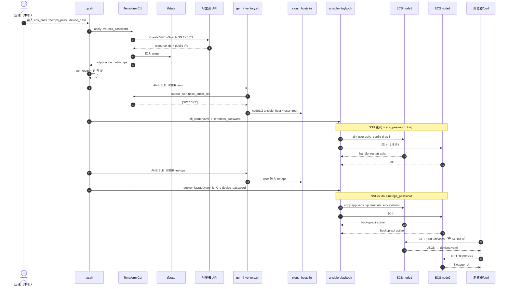
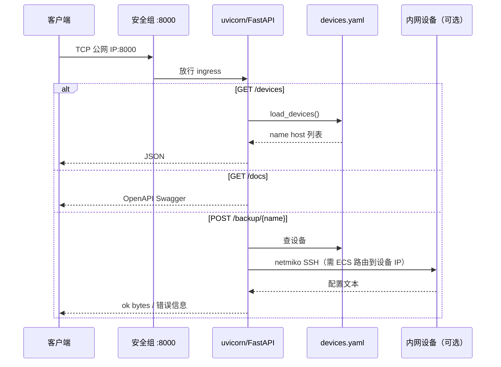
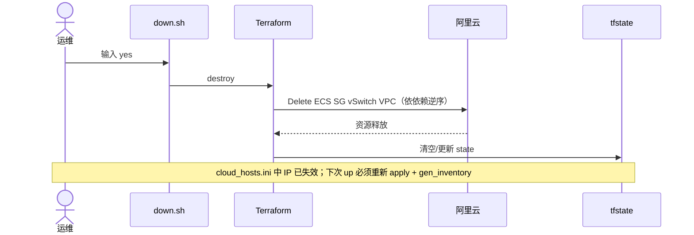

1.今日学习内容
### Day 127–133：Portfolio 双机栈（Terraform × Ansible × FastAPI）
> **定位**：在 Day 120–126「单机接缝」之上，做成 **可展示的一键 lab**：2× 按量 ECS、基线账号、双机 API、up/down 脚本。  
> **工程目录**：`~/code/127-132lab/`（与 `terraform-lab/`、`ansible-lab/` **并列**，state **独立**）。  
> **本机**：Rocky 控制节点；**包年 NetDevOps ECS 不参与** 本目录 `terraform.tfstate`。  
> **地域**：华北2 `cn-beijing`（与 120–123 一致）。

---
## 与前几段实验的对比
| 维度 | Day 120–126 | Day 127–132（本 portfolio） |
|------|-------------|------------------------------|
| Terraform 工程 | `terraform-lab/day120-123-ecs-stack/` | `127-132lab/terraform/` |
| ECS 数量 | 1 | **2**（`count = 2`） |
| Output | `node1_public_ip` | **`node_public_ips`**（列表） |
| Ansible | `ansible-lab/init_cloud.yaml` | `127-132lab/ansible/` + **deploy** |
| 应用 | 无 | **FastAPI + systemd :8000** |
| 一键 | 手工命令 | **`scripts/up.sh` / `down.sh`** |

---
## Day 127–128：双 ECS + 安全组 + inventory 接缝
### Terraform 要点（`127-132lab/terraform/main.tf`）
- `alicloud_instance.nodes` **`count = 2`**，`instance_name = sre-node-${count.index + 1}`
- 安全组：**22**（SSH）+ **8000**（API）
- `output "node_public_ips"` → `alicloud_instance.nodes[*].public_ip`
- PostPaid、`internet_max_bandwidth_out = 1`（要公网 IP 必须 >0）
- 余额不足仍会遇到 `InvalidAccountStatus.NotEnoughBalance`（见 day-120-123）

### inventory 脚本
```bash
cd ~/code/127-132lab
./scripts/gen_inventory.sh
# 默认 ansible_user=netops；全新机 init 前：ANSIBLE_USER=root ./scripts/gen_inventory.sh
```
`terraform output -json node_public_ips | jq -r '.[]'` → `cloud_hosts.ini` 的 `node1` / `node2`。

**完成标志**：两台 `ansible ping`（或 SSH）可达；SG 含 8000。

---
## Day 129：云主机基线 `init_cloud.yaml`
### Playbook 做什么
- dnf：EPEL、htop、vim、curl
- 用户 **netops**（`wheel`）+ 密码（`-e netops_password`，**勿写进 git**）
- **关 root SSH** + 实验环境保留 **PasswordAuthentication yes**
- handler：`notify: restart sshd`

### 踩坑（本机实录）
| 现象 | 原因 | 处理 |
|------|------|------|
| netops 无法登录 | `update_password: on_create`，用户已存在则 **不改密**；或首次 playbook 被 Ctrl+C 打断 | 改为 **`update_password: always`**；或控制台/`passwd` 补救 |
| node2 能 root 策略失败 node1 能 netops | 同上，仅 node1 手工改过密码 | 两台统一 `-e` 再跑 init |
| `sshd -T` 仍 `permitrootlogin yes` | 主配置 **先 `yes` 后 `no`**，OpenSSH **先出现的生效** | 删 `PermitRootLogin yes` 行 + drop-in `99-netops-no-root.conf` |
| `50-cloud-init.conf` 不存在 | 阿里云 **Rocky** 只有 `50-redhat.conf`，不是 Alibaba Cloud Linux 那套路径 | **不要** lineinfile 不存在的 drop-in |

**完成标志**：`ssh root@IP` 失败；`ssh netops@IP` 成功；inventory 改为 `ansible_user=netops`。

---
## Day 130：FastAPI 部署 `deploy_fastapi.yaml`
### 组件
| 路径 | 作用 |
|------|------|
| `app/main.py` | 自 day68 API 改：`DEVICE_PASSWORD` 环境变量（不用 `getpass`，适合 systemd） |
| `app/devices.yaml` | 设备清单（ECS 上 `/backup` 连内网 lab 设备常失败， **`/devices` + `/docs` 可验收**） |
| `systemd/backup-api.service` | `User=netops`，`uvicorn main:app --host 0.0.0.0 --port 8000` |
| `ansible/templates/backup-api.env.j2` | `DEVICE_PASSWORD={{ device_password }}` → `/opt/backup-api/.env` |

### 部署路径
- 代码与 venv：`/opt/backup-api/`
- 命令：`./scripts/deploy_api.sh` 或 `make deploy`（`-k -K` = netops SSH/sudo）

### 踩坑（本机实录）
| 现象 | 原因 | 处理 |
|------|------|------|
| pip `Permission denied` … `site-packages` | **root** 创建 venv，**netops** 跑 pip | venv 用 **`become_user: netops`**；删旧 root venv 再建 |
| 清华 PyPI **403** | ECS 出网访问镜像策略 | 改用 **`mirrors.aliyun.com/pypi/simple/`** + `trusted-host` |
| pip 任务「假死」 | Ansible 不刷进度 | 另开 SSH 看 `ps aux \| grep pip` |

**完成标志**：
```bash
curl -s http://<node1-ip>:8000/devices
curl -s http://<node2-ip>:8000/devices
# 浏览器 /docs
sudo systemctl is-active backup-api   # active
```

---
## Day 131–132：可重复运维与文档
### 脚本
| 脚本 | 作用 |
|------|------|
| `scripts/up.sh` | `apply` → 清 `known_hosts` → **root** init → **netops** inventory → deploy |
| `scripts/down.sh` | 输入 `yes` → `terraform destroy` |
| `scripts/gen_inventory.sh` | `ANSIBLE_USER` 默认 netops |
| `Makefile` | `make up` / `down` / `deploy` / `inventory` |

### 仓库卫生
- `.gitignore`：`*.tfstate*`、`cloud_hosts.ini`、`.env`
- `ansible/cloud_hosts.ini.example` 作模板
- 说明见 **`127-132lab/README.md`**

**完成标志**：README 能让他人理解流程；**不 destroy 时** `deploy` 幂等 `failed=0`。

---
## Day 133：周复盘——全流程时序与数据流（面试用）

> **目标**：一张图说清 **谁调谁**、**什么数据在哪传递**；能白板讲 1 分钟 + 答追问。

### 1. 三层分工（先建立 mental model）

```text
┌─────────────────────────────────────────────────────────────────┐
│ 编排层（本机 Rocky）                                              │
│  up.sh / gen_inventory.sh / ansible-playbook / terraform CLI     │
└───────────────┬───────────────────────────────┬───────────────────┘
                │ AK/SK + HCL                    │ SSH :22 + Python
                ▼                                ▼
┌───────────────────────────┐    ┌──────────────────────────────────┐
│ Terraform + tfstate       │    │ Ansible（读 cloud_hosts.ini）     │
│ 「资源是否存在」          │    │ 「机器里装什么、谁登录、服务状态」 │
└───────────────┬───────────┘    └──────────────────┬───────────────┘
                │ API                                │ module 到各 node
                ▼                                    ▼
┌─────────────────────────────────────────────────────────────────┐
│ 阿里云 cn-beijing：VPC · vSwitch · SG(22,8000) · ECS×2 · 公网 IP │
│ 进程：sshd · systemd backup-api · uvicorn:8000                  │
└─────────────────────────────────────────────────────────────────┘
```

| 层级 | 工具 | 状态存在哪 | 典型输入 | 典型输出 |
|------|------|------------|----------|----------|
| 云资源 | Terraform | `terraform.tfstate` | `-var ecs_password`、AK | `node_public_ips[]` |
| 接缝 | shell + jq | `ansible/cloud_hosts.ini` | `terraform output -json` | `ansible_host` + `ansible_user` |
| 配置 | Ansible | 目标机 `/etc`、`/opt` | `-e netops_password`、`-e device_password` | 幂等 changed/ok |
| 运行 | systemd | ECS 内存/磁盘 | `.env` `DEVICE_PASSWORD` | HTTP `:8000` |

**铁律**：Terraform **不** SSH 进机器；Ansible **不** 创建 ECS。接缝只有 **IP 列表** 从 output 进 inventory。

---

### 2. 主流程时序图（Provision → Configure → Verify）

下图覆盖 `./scripts/up.sh` 全路径；**箭头上的文字 = 数据/凭证/文件**。



---

### 3. 数据流表（面试追问「密码/IP 怎么传」）

| 阶段 | 数据 | 从哪来 | 到哪去 | 不进 git |
|------|------|--------|--------|----------|
| 建 ECS | `ecs_password` | 终端 `-var` / up.sh | 阿里云设置 root 初始密码 | ✓ |
| 接缝 | 公网 IP 列表 | `terraform output` | `cloud_hosts.ini` 的 `ansible_host` | ini 可 gitignore |
| 基线 | `netops_password` | `-e` / up.sh | `/etc/shadow`（hash） | ✓ |
| 基线 | SSH 登录身份 | inventory | init 用 **root**；之后 **netops** | — |
| 部署 | `app/*` | 控制机 git 目录 | ECS `/opt/backup-api/` | 代码可提交 |
| 部署 | `device_password` | `-e` | `/opt/backup-api/.env` → systemd `EnvironmentFile` | ✓ |
| 运行 | 设备列表 | `devices.yaml` | FastAPI 读文件返回 `/devices` | 可提交（无密） |
| 运行 | 设备 SSH 密 | `DEVICE_PASSWORD` env | netmiko `/backup/{name}`（需路由可达） | ✓ |

**state 与 inventory 分工**：IP 变了只改 **terraform apply + gen_inventory**；账号策略变了跑 **init**；应用变了跑 **deploy**——三者可独立幂等。

---

### 4. 运行时请求流（服务起来之后）



网工类比：**SG = ACL**，**systemd = 进程守护**，**FastAPI = 应用协议**，**Terraform = 机架/线路有没有**，**Ansible = 上架装系统装服务**。

---

### 5. 销毁流（省钱闭环）



---

### 6. ASCII 总览（无法渲染 Mermaid 时白板）

```text
运维 ──apply(ecs_pass)──► Terraform ──API──► 阿里云(2×ECS, IP1 IP2)
         │                      │
         │                      └──output──► gen_inventory ──► cloud_hosts.ini
         │
         ├──ansible init(-e netops_pass, SSH=root/ecs_pass)──► node1,2 基线
         ├──gen_inventory(netops)──► 改 ini 用户
         └──ansible deploy(-e device_pass)──► /opt/backup-api + systemd

用户 ──:8000──► SG ──► uvicorn ──► devices.yaml / (可选) netmiko ──► 设备
```

---

### 7. 面试口述稿（约 60 秒，可背诵）

「这个 lab 我用 **Terraform** 在北京按量拉起 **VPC、子网、安全组只开 22 和 8000、两台 ECS**，公网 IP 写在 **tfstate** 里，用 **output** 导出。  
**接缝**是一个 shell：`terraform output` 生成 **Ansible inventory**，这样 IP 变了我不会手改一堆 playbook。  
第一阶段 **Ansible init** 用 **root** 登录，装包、建 **netops**、关 **root SSH**；第二阶段 inventory 换成 netops，**deploy** 把 FastAPI 拷到 `/opt/backup-api`，**venv + pip**，用 **systemd** 拉 **uvicorn**。  
秘密分三类：**ecs 密码**只给 Terraform 和首次 SSH，**netops 密码**给运维 SSH/sudo，**设备密码**进 **EnvironmentFile**，都不进 git。  
验收是 curl 两台 **/devices** 和 **/docs**。练完 **terraform destroy** 避免按量空烧。  
边界上我坚持 **Terraform 管资源、Ansible 管机器内状态**，不混用，这样职责清晰、也好排查。」

---

### 8. Day 133 验收（自测）

- [ ] 能 **不看文档** 画出版本 6 的 ASCII 或讲清 mermaid 主流程  
- [ ] 能说明 **三种密码** 分别在哪一步、存在哪  
- [ ] 能解释 **为何 init 用 root、deploy 用 netops**  
- [ ] 能说明 **destroy 后** 哪些文件/状态必须重做  
- [ ] 计时：从 `up.sh` 到双机 `/docs` 可用，记录分钟数写进 (4) 下方

(4) 本 lab 全流程（up.sh 或等价）耗时：______ 分钟；瓶颈：______（常见：pip / ECS 创建）

---
## 命令速查（重建全流程）
```bash
cd ~/code/127-132lab
./scripts/up.sh
# 或分步见 127-132lab/README.md

# 练完省钱
./scripts/down.sh
```

---
## 2.验收
(1) 为什么 portfolio 用 **2 台 ECS** 而不是 1 台？  
答: 练习 **count/output 列表**、inventory 多主机、相同 playbook 并行；更接近「多节点」生产叙事（仍是最小 lab）。

(2) Terraform 与 Ansible 的边界在本 lab 里各管什么？  
答: TF = VPC/子网/SG/ECS/公网 IP；Ansible = OS 包、账号、sshd 策略、应用目录、venv、systemd；**不**用 Ansible 创建 ECS。

(3) `gen_inventory.sh` 为什么要有 `ANSIBLE_USER=root|netops`？  
答: **新机只有 root+ecs_password** 能 SSH；init 关 root 后必须用 **netops** 做后续 deploy。

(4) systemd 里为什么用环境变量文件而不是 playbook 写死设备密码？  
答: 秘密与代码分离；`.env` 权限 0600；playbook 用 `-e device_password` 注入模板，不进 git。

(5) 本 lab 完成后，你认为最大的三个坑是什么？  
答:① `on_create` 不设密 ② root venv + netops pip ③ SSH 双行 PermitRootLogin / 镜像 403——都指向 **幂等、属主、先验证再关 root** 的纪律。

(6) destroy 不做的后果？  
答: PostPaid ECS 持续计费；公网 IP/磁盘按量；portfolio 练完应 **down.sh** 或控制台确认无残留。

---
## 与 neteng-to-sre 其它作品的衔接
- API 逻辑源自 `scripts/week9-12/day67-70/day68_API.py`（备份平台 REST 壳）
- 配置备份 **v2** 仍是本地/内网设备；本 lab 的 API 在 **公网 ECS** 上，设备 IP 需在 `devices.yaml` 中可达才 backup 成功
- Day 124–126 单机 seam 技能 **直接复用到** 本目录，只是 **工程收敛到 127-132lab 一个 repo**
